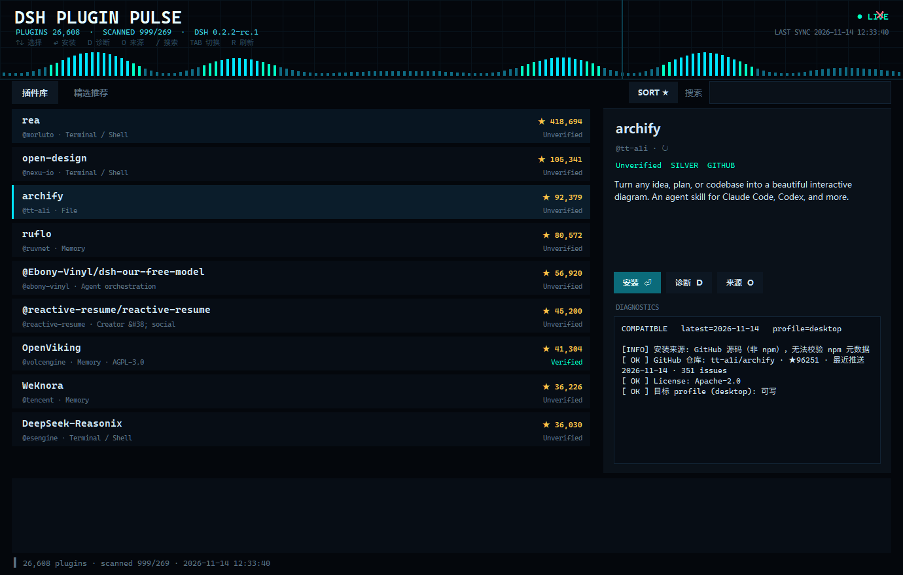
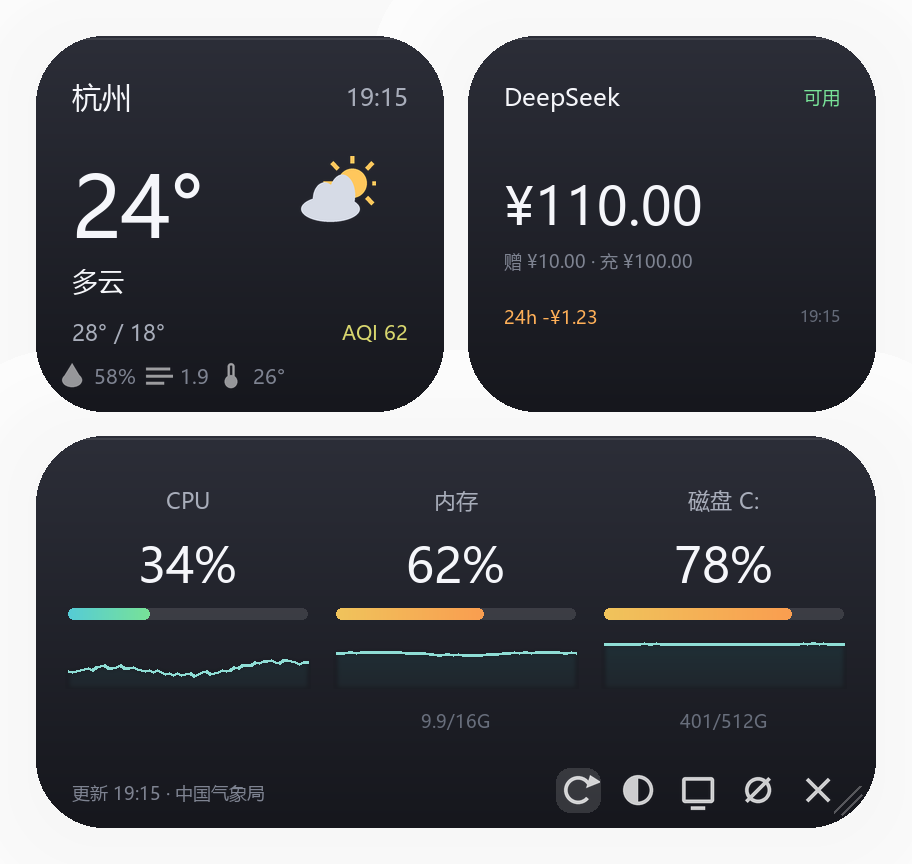

# DIY-code

**Windows 桌面小工具 + DeepSeek Harness 插件合集。** 科技新闻聚合、Codex 环境搬运、汉化流水线、桌面桌宠——
16 个解压即用的小程序，全部 MIT，全部源码可读。

[](https://github.com/YYY-DXS/DIY-code/releases)
[](LICENSE)
[](https://github.com/YYY-DXS/DIY-code/actions/workflows/release.yml)
[](https://github.com/YYY-DXS/DIY-code/actions/workflows/build-binaries.yml)

<table>
<tr>
<td width="62%"></td>
<td width="38%"></td>
</tr>
<tr>
<td align="center"><sub>DSH 插件面板：检索 2 万+ 插件、一键安装、装前兼容性诊断</sub></td>
<td align="center"><sub>桌面小组件：天气 / DeepSeek 余额 / CPU 内存悬浮窗</sub></td>
</tr>
</table>


最新发行版：[v2.2.3](https://github.com/YYY-DXS/DIY-code/releases/tag/v2.2.3)

## 快速开始

1. 到 [最新发行版](https://github.com/YYY-DXS/DIY-code/releases/latest) 下载需要的 zip（每个软件一个包）
2. 解压到任意目录，**不要**放在 `C:\Program Files`（需要写配置和日志）
3. 双击 `启动.cmd`，或直接运行 exe
4. 首次运行会被 SmartScreen 拦一次，处理方式见 [首次运行提示](#首次运行提示)

想核对下载完整性：

```powershell
Get-FileHash .\tech-pulse.zip -Algorithm SHA256   # 与 Release 里的 SHA256SUMS.txt 对照
```

## 功能清单

### 桌面工具（`apps/`）

| 工具 | 一句话 |
| --- | --- |
| **科技脉冲** | 每日科技新闻 + DIY 项目聚合，英文自动译中文，本地 Web UI |
| **桌面小组件** | 七张独立卡片：天气、DeepSeek 余额、资源、音量、音乐、蓝牙电量、日历 |
| **电脑管家** | 系统体检、环境修复、深度垃圾与隐私清理、文件整理 |
| **Codex 环境搬运** | 把 Codex 工作环境盘点、打包、还原、加密，换机不丢配置 |
| **DSH 插件面板** | 可视化安装 / 卸载 DSH 插件，装前检查版本兼容性 |
| **Lumen 译** | 划词 / 截图翻译，支持在线线路与 OpenAI 兼容引擎 |
| **汉化工具** | 通用软件汉化流水线：提取、翻译、占位符保护、回写 |
| **RAW 转 JPG** | 批量 RAW / 图片转 JPEG，附完整 C# 源码 |

### DeepSeek Harness 插件（`plugins/`）

每个插件都可以直接装，或从独立仓库安装：

```bash
dsh plugin add github:YYY-DXS/dsh-query-bridge
```

| 插件 | 作用 | 独立仓库 |
| --- | --- | --- |
| DeepSeek Hub | 网页会话同步成本地知识库，并发布 DIY 项目到 GitHub | [dsh-deepseek-hub](https://github.com/YYY-DXS/dsh-deepseek-hub) |
| Media Studio | 让 Agent 驱动本机 FilmCraft / EffectCraft / PhotoCraft / LightCraft | [dsh-media-studio](https://github.com/YYY-DXS/dsh-media-studio) |
| Query Bridge | 查 GitHub 仓库状态、DeepSeek 余额、历史会话 | [dsh-query-bridge](https://github.com/YYY-DXS/dsh-query-bridge) |
| Codex History Bridge | 把本机 Codex 历史导入工作区 | [dsh-codex-history-bridge](https://github.com/YYY-DXS/dsh-codex-history-bridge) |
| 鲸鱼提示 | 任务完成或有待回复的问题时，播提示音、弹鲸鱼娘卡片 | [dsh-whale-notify](https://github.com/YYY-DXS/dsh-whale-notify) |

### 生成器（`extras/`）

- **高中政治思维导图**：必修 1–2 全套，A4 一框一页，可直接打印

## 使用示例

**科技脉冲**——解压后双击 `start.cmd`，浏览器打开 `127.0.0.1:4173`，右下角可切换只看中文源：

```
tech-pulse/
├─ start.cmd        ← 双击这个
├─ server.mjs
└─ reports/         ← 每天一份 Markdown 日报
```

**桌面小组件**——`启动浮窗.bat` 后右键卡片改城市、填 DeepSeek API Key；配置存在本地 `config.json`，不上传。

**插件面板**——双击 `启动脉冲面板.cmd`，搜索 → 诊断 → 安装；它会在装之前检查你的 DSH 版本和 Node 版本。

## 已知限制

- **未签名**：exe 没有商业代码签名证书，首次运行必然被 SmartScreen 拦一次（见下文）
- **仅 Windows**：全部为 Windows 10/11 编写，未在 Linux/macOS 测试
- **插件绑定 DSH 版本**：`engines.dsh` 为 `>=0.1.0-rc.6 <0.3.0-0`，超出范围不保证可用
- **联网功能需要自己的 Key**：余额查询、在线翻译要走你自己的 DeepSeek / OpenAI 兼容接口
- **界面以中文为主**：英文只在部分工具和插件描述里覆盖
- **桌宠**：部分高 DPI 多屏环境可能位置偏移，欢迎提 issue 附截图

## Roadmap

- [ ] 全部 exe 改为 CI 构建并代码签名（[docs/code-signing.md](docs/code-signing.md)）
- [ ] 5 个插件上架 dshbase，补齐 `dsh-plugin` 话题与实测记录
- [ ] 科技脉冲：自定义源、只看中文源、历史日报检索
- [ ] 打包体积与冷启动优化（PyInstaller onedir → 更小的运行时）
- [ ] 英文 README 与英文界面

## 项目结构

| 目录 | 说明 |
| --- | --- |
| [`apps/`](apps/README.md) | 独立 Windows 桌面工具 |
| [`plugins/`](plugins/README.md) | DeepSeek Harness 宿主插件（含[发布仓库清单](plugins/README.md#已发布仓库)） |
| [`extras/`](extras/README.md) | 单独发布的生成器与脚本 |
| [`projects/`](projects/README.md) | DIY 项目资料（齐柏林飞艇、外骨骼、台历、航模方向） |
| [`tools/`](tools/README.md) | 配套工具：同步、发布、隐私检查、Markdown 转换 |
| [`docs/`](docs/) | 首次运行提示、代码签名方案与发布检查清单 |

仓库里只保留 Markdown 与源码：`.md` / `.js` / `.mjs` / `.py` / `.ps1` / `.cs`，以及作为程序入口的 `.html`。
Word、生成的 HTML 阅读版、zip 都不进仓库。改完 `.md` 后本地重新生成阅读版：
`python tools/md2readable/md_to_readable.py`。

发版流程：改 `VERSION` → 打 tag → `Publish apps` 自动打包并发布。
插件改动后跑 `./tools/publish-plugin.ps1 -All` 同步 5 个独立仓库。

## 首次运行提示

解压后运行 exe，Windows 可能弹出「Windows 已保护你的电脑」。**这不是报毒**：本项目没有购买商业代码签名证书，
SmartScreen 对「未知发布者 + 新文件」一律拦截。

确认来源后，任选一种通过：

1. 点弹窗里的 **更多信息** → **仍要运行**
2. 右键 exe → **属性** → 勾选 **解除锁定** → 确定
3. PowerShell：`Unblock-File .\程序.exe`

**当前状态：尚未签名。** 请用 `SHA256SUMS.txt` 核对完整性。签名机制与后续方案见
[docs/首次运行与签名.md](docs/首次运行与签名.md)。

## 代码签名

Windows 可执行文件由 CI 从源码构建，脚本是 [`tools/build/build-binaries.ps1`](tools/build/build-binaries.ps1)，
构建记录见 Actions 的 **Build binaries**，产物是 artifact `binaries-<版本>`。

Free code signing provided by [SignPath.io](https://about.signpath.io), certificate by [SignPath Foundation](https://signpath.org).

- Committers and reviewers: [@YYY-DXS](https://github.com/YYY-DXS)
- Approvers: [@YYY-DXS](https://github.com/YYY-DXS)
- Privacy policy: 不收集遥测，不上传任何使用数据。联网只发生在你主动使用的功能上——天气与 AQI、DeepSeek 余额查询、科技新闻抓取、在线翻译；API Key 与历史记录仅保存在本机（`config.json`、`data/`），不会进入仓库。

> SignPath Foundation 的申请状态见 [docs/code-signing.md](docs/code-signing.md)。审批通过前，上述签名政策尚未生效。

## 许可

本项目采用 [MIT 许可](LICENSE)：任何人都可以自由使用、修改、再发布，只要保留版权声明即可。
