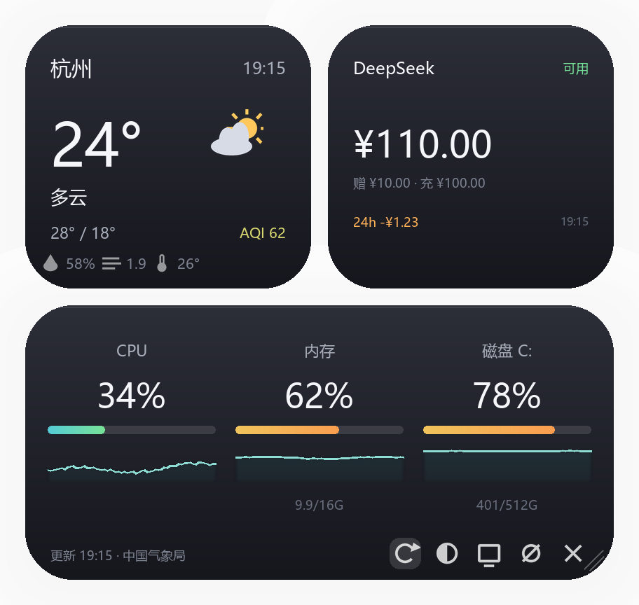

# 桌面浮窗小组件（天气 / DeepSeek 余额 / 系统资源）

Windows 版的「手机小组件」：三张半透明圆角卡片飘在桌面上，置顶、点击不抢焦点、
不占任务栏、不进 Alt+Tab，可以拖走、可以拖大拖小，还有一个系统托盘图标兜底。



## 三块内容

| 卡片 | 显示什么 | 数据来源 |
| --- | --- | --- |
| 天气 | 杭州实时天气 + 今日高低温 + 降水概率/AQI | 中国气象局（中国天气网数据），可切和风天气 |
| DeepSeek 余额 | 账户余额、赠金/充值拆分、近 24h 消耗 | DeepSeek 官方接口，需要 API Key |
| 系统资源 | CPU 占用 + 走势图、内存、C 盘 | ctypes 直接读 Windows，零依赖 |

## 跑起来

双击 **`启动浮窗.bat`** 即可（它会用 Codex 自带的 Python 在后台启动，不弹黑框）。
如果双击后没反应，改用 **`诊断模式.bat`**：它会带着控制台窗口跑，报错信息直接显示出来，
窗口关掉浮窗就跟着关。

命令行也可以：`python widget.py`；只想看外观不开窗：`python widget.py --preview preview.png`

> 注意：`.bat` 必须是 **CRLF 换行**。cmd 解析 LF 换行的批处理会错位，
> 表现为双击一闪而过、什么都不发生（这个坑踩过）。

## 桌面快捷方式

启动后如果桌面上还没有「桌面小组件」图标，程序会**自己建一个**（带图标、带参数）。
托盘右键菜单里也有「创建桌面快捷方式」，删了或想重建随时点。

由程序自己建是有原因的：只有进程知道自己在用哪个解释器路径。Codex 换了运行时、
路径变了，下次启动它会自己重建，快捷方式不会变成死链。

再点一次快捷方式不会开出第二个浮窗 —— 已经开着就把已有的叫到前台来（单实例）。

备用启动方式：`启动浮窗.bat`（常规）、`启动.vbs`（一行版，快捷方式失效时用）。

## 调整大小

**右下角有三道斜线的地方就是缩放把手**，按住往右下拖变大、往左上拖变小，
范围 0.55 ~ 2.2 倍，松手自动记住。缩放是等比缩放（字、图标、圆角一起变），
不是拉伸变形，所以在任何尺寸下都清晰。

整块界面是接近正方形的布局（420 × 396）：上面并排两张方卡片，下面一张通栏卡片。

**拖到很小的时候会自动切「精简模式」**：湿度、风速、体感、赠金充值明细、磁盘绝对值
这些次要信息会收起来，只保留温度、天气、余额、CPU/内存/磁盘百分比 —— 
字不会小到看不清（有 9 像素的下限），缩到最小也一眼能看到关键数字。

**三条折线图任何尺寸都显示**：精简模式下不隐藏，反而把位置让给它们、画得更高一点。
程序刚启动还没有历史数据时会先画一条平线，不会空着等。

## 系统托盘

启动后任务栏托盘区会有一个图标（深色圆角方块 + 绿色折线）。

- **双击 / 单击图标**：显示或隐藏浮窗
- **右键图标**：菜单 —— 显示(隐藏)浮窗 / 重置位置与大小 / 开机自动启动 / 退出
- **鼠标悬停**：气泡提示显示当前 CPU 和内存占用

托盘图标不只是好看，它是**唯一一定可用的出口**：鼠标穿透打开后窗口不吃任何点击，
这时候从托盘菜单里「重置位置与大小」或「退出」永远有效。

想让程序启动后只待在托盘里、不占桌面，把 `config.json` 里的 `start_hidden` 设成 `true`。

## 快捷键

程序会从一串候选里挑一个没被占用的组合（你机器上 Ctrl+Alt+W 已被别的软件占用，
所以自动跳过了它）：

| 快捷键 | 作用 |
| --- | --- |
| **Ctrl + Alt + Shift + W** | 复位：穿透 / 桌面层 / 透明度 / 位置全部归位 |
| **Ctrl + Alt + Q** | 直接退出 |

启动时卡片上会弹一行提示，告诉你这次实际用的是哪两个键。用的是哪一组可以看
`widget.log`。

## 其它操作

| 操作 | 效果 |
| --- | --- |
| 按住卡片空白处拖动 | 移动位置，松手自动记住 |
| 右下角斜线处拖动 | 缩放大小 |
| 卡片右上角 ⟳ | 立刻刷新天气和余额 |
| 卡片右上角 ◐ | 循环切换 100% / 90% / 78% / 62% 不透明度 |
| 卡片右上角 显示器图标 | 贴到桌面层，变成会被普通窗口盖住的「桌面挂件」 |
| 卡片右上角 ⊘ | 鼠标穿透，**10 秒后自动解除**，卡片上会显示倒计时 |
| 卡片右上角 ✕ | 退出 |
| 右键点击卡片 | 同复位快捷键 |

## 天气数据来自哪里

卡片上天气的来路按顺序自动挑，谁先成功用谁，卡片左上角会标出实际用的是哪个源：

| 源 | 说明 | 需要 Key |
| --- | --- | --- |
| `cma` 中国气象局 | 走中国天气网的数据接口（实况 + 今日高低温 + AQI）。国内权威、免密钥，但接口不是公开文档化的，所以代码里同时用三个端点互相兜底 | 不需要 |
| `qweather` 和风天气 | 官方 API，稳定有文档，国内大多数应用走它。免费额度够个人用 | 需要 |
| `open-meteo` | 国外开放源，只当兜底 | 不需要 |

默认 `auto`：中国气象局 → 和风天气 → Open-Meteo。想固定用某一个，改
`config.json` 里的 `weather.source`（写 `cma` / `qweather` / `open-meteo`）。

不确定哪条路能通，就双击 **`检测天气源.bat`**，它会三个源挨个试一遍并打印结果。

**城市编码**：`weather.cma_city_id`，杭州是 `101210101`，和风天气用的是同一套
LocationID，所以填一次两边都认。换城市可以去中国天气网搜到对应编号。

**和风天气的 Key** 放在 `weather.qweather.key`，或环境变量 `QWEATHER_KEY`，
或者写进 `api.txt` 里备注带「天气」的那一行（`weather.qweather.key_hint` 可以改这个词）。
新注册的和风账号会分配一个专属 API Host（形如 `xxxxx.re.qweatherapi.com`），
如果是这种，把主机名填到 `weather.qweather.api_host`。

## 配上 DeepSeek API Key

按这个顺序找 Key，先找到的先用：

1. **`api.txt` 里带备注、且备注命中 `key_hint`（默认「余额」）的那把** —— 意图最明确
2. `config.json` 里的 `deepseek.api_key`
3. 环境变量 `DEEPSEEK_API_KEY`
4. `api.txt` 里的第一把

`api.txt` 的位置按「脚本旁边 → 桌面 → 文档」依次查找。

`api.txt` 里可以放**多把 Key**，一行一把，用破折号写上用途备注：

```
sk-xxxxxxxx——codex
sk-yyyyyyyy——lumen翻译
sk-zzzzzzzz——余额
```

默认挑备注里带「余额」的那把（这张卡片查的就是余额），找不到就退回第一把。
想换用途改 `config.json` 的 `deepseek.key_hint` 就行。

Key 在 platform.deepseek.com 的 API keys 页面创建。没填 Key 时卡片显示「未接入」，
其余两块照常工作。

关于「用量」有一点要说清楚：DeepSeek 官方开放的是**余额查询**接口
（`GET https://api.deepseek.com/user/balance`，返回总额/赠金/充值），
**没有**逐 token 的历史用量接口。所以卡片显示的是余额加本地记录的消耗 ——
每次查到余额都会写进 `balance_history.json`，攒够一小时的样本就开始显示「近 24h 消耗」。
第一次打开会看到「采样中…」，这是正常的。

## 配置项一览（config.json）

| 键 | 说明 |
| --- | --- |
| `city` / `latitude` / `longitude` | 城市名和坐标 |
| `weather_refresh_minutes` | 天气刷新间隔，默认 10 分钟 |
| `weather.source` | `auto` / `cma` / `qweather` / `open-meteo` |
| `weather.cma_city_id` | 城市编码，杭州 `101210101` |
| `weather.qweather.api_host` | 和风 API Host，默认 `devapi.qweather.com` |
| `weather.qweather.key` / `key_hint` | 和风 Key，或从 api.txt 里按备注找 |
| `deepseek.api_key` | DeepSeek API Key，留空则用环境变量 |
| `deepseek.refresh_minutes` | 余额刷新间隔，默认 5 分钟 |
| `resources.disk` | 监控哪个盘，比如 `"D:"` |
| `resources.sample_seconds` | 系统资源采样间隔，默认 2 秒 |
| `resources.cpu_history` | CPU 走势图保留多少点（60 点 × 2 秒 = 近 2 分钟） |
| `scale` | 界面缩放倍率，拖动把手会自动改这个值 |
| `start_hidden` | `true` = 启动后只驻留托盘，不显示浮窗 |
| `clickthrough_seconds` | 穿透自动解除秒数，`0` = 永久穿透 |
| `opacity_levels` | ◐ 按钮循环的不透明度档位 |
| `position` | 窗口位置，拖动后自动记录 |

## 排错

程序是后台运行的，看不到控制台输出，所以会把关键事件写进 `widget.log`
（每次启动清空）：快捷键注册结果、托盘图标是否加入成功、缩放、退出。
双击 `.bat` 没用、托盘图标不见了，先看这个文件。

常见的一条：日志里出现
`取数失败: <urlopen error [WinError 10013] 以一种访问权限不允许的方式做了一个访问套接字的尝试>`
说明**这个进程自己没有联网权限**，不是机器没网。被受限环境（沙箱、防火墙白名单、
公司策略）启动时会出现，此时天气会退化成「离线 · 示例数据」、DeepSeek 卡片显示网络不可用。
用自己的账号双击 `启动浮窗.bat` 启动就没有这个问题。

## 开机自启

托盘右键菜单里勾「开机自动启动」即可，它会在启动文件夹放一个 `.vbs`
（比 `.bat` 干净，不会闪黑框）。取消也是同一个菜单项。
手动位置：`%APPDATA%\Microsoft\Windows\Start Menu\Programs\Startup\桌面小组件.vbs`

## 代码里值得抄走的八个点

1. **逐像素透明**：`UpdateLayeredWindow` + 32 位 BGRA 位图，圆角和柔光投影都是画出来的，
   不是贴图也不是色键抠图。同一个调用换个尺寸参数就能缩放窗口，不用重建。
2. **浮层行为**：`WS_EX_LAYERED | WS_EX_TOOLWINDOW | WS_EX_NOACTIVATE`，
   分别解决「透明」「不进 Alt+Tab / 任务栏」「点击不抢焦点」。
   注意还得 `ShowWindow(SW_SHOWNOACTIVATE)` —— 不带 `WS_VISIBLE` 的窗口画了也不显示。
3. **自己画按钮和把手**：鼠标消息全部自己处理，窗口长什么样完全自由。
4. **后台取数 + PostMessage**：网络请求在后台线程，取完只往 UI 线程发一条自定义消息。
5. **系统资源零依赖**：`GetSystemTimes`（CPU 增量法）、`GlobalMemoryStatusEx`（内存）、
   `GetDiskFreeSpaceExW`（磁盘），不需要 psutil，也不需要管理员权限。
6. **托盘图标自己生成**：PIL 画 32×32 图像 → `CreateDIBSection` 填 BGRA →
   `CreateIconIndirect` 得到 HICON → `Shell_NotifyIconW`。不需要 .ico 文件。
   `NOTIFYICONDATAW` 在 x64 下必须是 976 字节，字段顺序错一个就静默失败。
7. **快捷键要挑**：`RegisterHotKey` 会失败（组合被别的软件占了），必须逐个候选尝试
   并把真正注册成功的那个告诉用户 —— 不然关键时刻按下去毫无反应。
8. **桌面层**：`SetParent` 到桌面的 `WorkerW` 图层就变成真正的桌面挂件，
   动态壁纸用的是同一套办法。

另外提醒一句：PIL 往 RGBA 图上直接画半透明颜色是「覆盖」不是「混合」，
会画出透明窟窿，代码里的 `layer()` 就是干这个的 —— 带 alpha 的图形一律先画在独立图层再合并。
