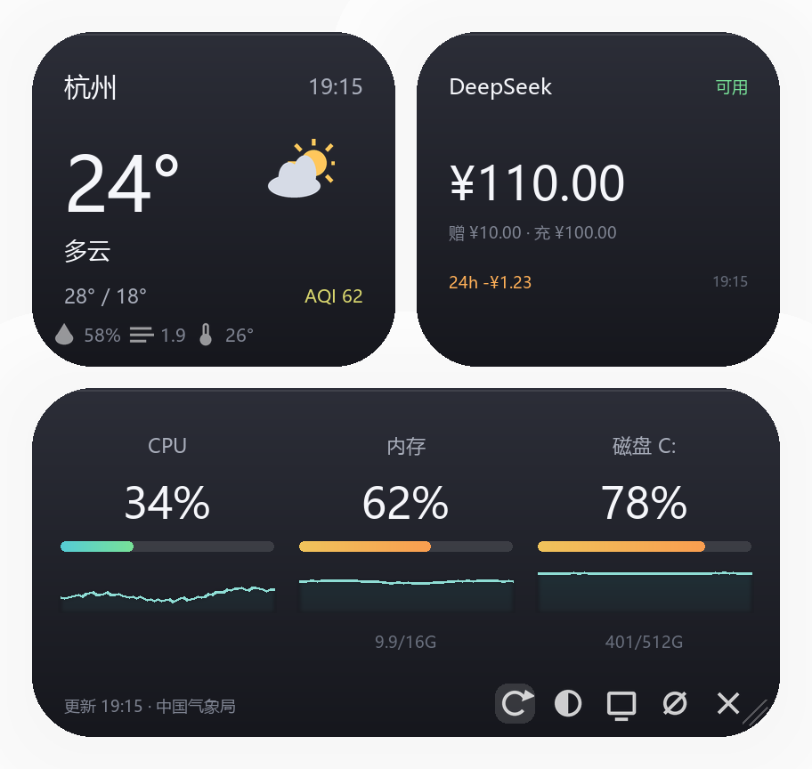

# 桌面小组件（天气 / 余额 / 资源 / 音量 / 音乐 / 电量 / 日历）

Windows 版的「手机小组件」：七张**独立卡片**，各自一个窗口，可以单独拖动、松手吸附、
对齐参考线，还能从「添加组件」里显示/隐藏。
置顶、点击不抢焦点、不占任务栏、不进 Alt+Tab，系统托盘兜底。



## 七块内容

| 卡片 | 显示什么 | 数据来源 |
| --- | --- | --- |
| 天气 | 杭州实时天气 + 今日高低温 + 降水概率/AQI | 中国气象局，可切和风天气 |
| DeepSeek 余额 | 账户余额、赠金/充值拆分、近 24h 消耗 | DeepSeek 官方接口，需要 API Key |
| 系统资源 | CPU 占用 + 走势图、内存、C 盘 | ctypes 直接读 Windows |
| 音量混音器 | 主音量/静音 + 每个应用单独 ±5% | 常驻 `AudioBridge.exe`（WASAPI） |
| 音乐播放器 | 标题、歌手、播放状态、上一首/播放/下一首 | Windows GSMTC（`winrt`） |
| 蓝牙电量 | 设备名；Windows 能读到时显示百分比 | BLE / Windows 可读设备 |
| 日历 | 今天/未来 7 天事件 | ICS 订阅 URL 或本地 `.ics` |

## 跑起来

双击 **`启动.bat`** 即可（桌面「桌面小组件」也是它）。启动器会自动寻找本机可用的
Python，并检查 Pillow 和 `winrt` 媒体依赖；缺了会执行 `pip install -r requirements.txt`
（只装一次），再用 pythonw 在后台拉起卡片，不弹黑框。

也可以手动安装依赖：

```powershell
python -m pip install -r requirements.txt
```

如果双击后没反应，在命令行运行 `python cards.py`，控制台会直接显示报错。
只想看旧版整块浮窗的外观：`python widget.py --preview preview.png`

> 注意：`.bat` 必须是 **CRLF 换行**。cmd 解析 LF 换行的批处理会错位，
> 表现为双击一闪而过、什么都不发生（这个坑踩过）。

## 卡片式桌面

- 七张卡各自一个窗口，独立拖动
- 松手吸附到 **40px 网格**；离屏幕边缘、其他卡片边缘/中心 40px 内会磁吸对齐
- 拖动时显示**落点阴影**和**细虚线**对齐参考线
- 位置、单卡缩放、显示状态写进 `config.json` 的 `cards` 字段，重启恢复
- **单卡缩放**：拖卡片右下角的斜线把手，每张卡独立缩放（0.6× ~ 2.2×）
- 托盘菜单 / 卡片右键：
  - 隐藏 / 显示卡片
  - 隐藏这张卡 / 重置这张卡大小
  - 重置卡片位置
  - 锁定布局
  - **添加组件…**：七张卡逐项显示/隐藏
  - 退出
- 快捷键：`Ctrl+Alt+Shift+W` 重置布局，`Ctrl+Alt+Shift+Q` 退出

**只在桌面层**：普通窗口在前台时卡片退到最底层，不会盖住浏览器/游戏；回到桌面时再置顶显示。

当前边界：只处理主屏、卡与卡重叠时不会自动让位。

### 日历配置

在 `config.json` 里填：

```json
"calendar": {
  "ics": "https://example.com/me.ics",
  "name": "我的日历"
}
```

也支持本地路径，例如 `"ics": "D:\\calendar.ics"`。只读，不会修改日历。


## 桌面快捷方式

安装包/本机已经建好唯一的「桌面小组件」快捷方式，指向 `启动.bat`。
再点一次不会开出第二套 —— 已经开着就把卡片重新显示（回桌面查看；它们不会盖住其他窗口）。

命令行备用启动：`python cards.py`。

## 尺寸

`config.json` 的 `scale`（默认 0.55）决定所有卡的初始大小；每张卡右下角的斜线把手
可以单独缩放，范围 0.6× ~ 2.2×，保存在 `cards.zooms`。
右键卡片「重置这张卡大小」恢复到 1.0×。

## 系统托盘

启动后任务栏托盘区会有一个图标（深色圆角方块 + 绿色折线）。

- **双击 / 单击图标**：显示或隐藏卡片
- **右键图标**：菜单 —— 显示/隐藏卡片 / 重置卡片位置 / 锁定布局 / 添加组件… / 退出
- **鼠标悬停**：气泡提示显示当前卡片数量

托盘图标是**唯一一定可用的出口**：卡片隐藏后，从托盘菜单可以重新显示或退出。

## 快捷键

| 快捷键 | 作用 |
| --- | --- |
| **Ctrl + Alt + Shift + W** | 重置所有卡片位置并解除锁定 |
| **Ctrl + Alt + Shift + Q** | 直接退出 |

## 其它操作

| 操作 | 效果 |
| --- | --- |
| 按住卡片空白处拖动 | 移动该卡片，松手吸附到 40px 网格并保存 |
| 拖到屏幕边缘/其他卡片附近 | 出现青色对齐线和落点阴影，松手对齐 |
| 卡片右上角 ⟳ | 立刻刷新天气和余额 |
| 卡片右上角 ◐ | 循环切换 100% / 90% / 78% / 62% 不透明度 |
| 卡片右上角 ⊘ | 鼠标穿透，**10 秒后自动解除** |
| 卡片右上角 ✕ | 退出 |
| 右键点击卡片 | 打开托盘同款菜单（含「添加组件…」） |

## 天气数据来自哪里

卡片上天气的来路按顺序自动挑，谁先成功用谁，卡片左上角会标出实际用的是哪个源：

| 源 | 说明 | 需要 Key |
| --- | --- | --- |
| `cma` 中国气象局 | 走中国天气网的数据接口（实况 + 今日高低温 + AQI）。国内权威、免密钥，但接口不是公开文档化的，所以代码里同时用三个端点互相兜底 | 不需要 |
| `qweather` 和风天气 | 官方 API，稳定有文档，国内大多数应用走它。免费额度够个人用 | 需要 |
| `open-meteo` | 国外开放源，只当兜底 | 不需要 |

默认 `auto`：中国气象局 → 和风天气 → Open-Meteo。想固定用某一个，改
`config.json` 里的 `weather.source`（写 `cma` / `qweather` / `open-meteo`）。

不确定哪条路能通，就运行 `python widget.py --probe`，它会三个源挨个试一遍并打印结果。

**城市编码**：`weather.cma_city_id`，杭州是 `101210101`，和风天气用的是同一套
LocationID，所以填一次两边都认。换城市可以去中国天气网搜到对应编号。

**和风天气的 Key** 放在 `weather.qweather.key`，或环境变量 `QWEATHER_KEY`，
或者写进 `api.txt` 里备注带「天气」的那一行（`weather.qweather.key_hint` 可以改这个词）。
新注册的和风账号会分配一个专属 API Host（形如 `xxxxx.re.qweatherapi.com`），
如果是这种，把主机名填到 `weather.qweather.api_host`。

## 配上 DeepSeek API Key

按这个顺序找 Key，先找到的先用：

1. **`api.txt` 里带备注、且备注命中 `key_hint`（默认「余额」）的那把** —— 意图最明确
2. `config.json` 里的 `deepseek.api_key`
3. 环境变量 `DEEPSEEK_API_KEY`
4. `api.txt` 里的第一把

`api.txt` 的位置按「脚本旁边 → 桌面 → 文档」依次查找。

`api.txt` 里可以放**多把 Key**，一行一把，用破折号写上用途备注：

```
sk-xxxxxxxx——codex
sk-yyyyyyyy——lumen翻译
sk-zzzzzzzz——余额
```

默认挑备注里带「余额」的那把（这张卡片查的就是余额），找不到就退回第一把。
想换用途改 `config.json` 的 `deepseek.key_hint` 就行。

Key 在 platform.deepseek.com 的 API keys 页面创建。没填 Key 时卡片显示「未接入」，
其余两块照常工作。

关于「用量」有一点要说清楚：DeepSeek 官方开放的是**余额查询**接口
（`GET https://api.deepseek.com/user/balance`，返回总额/赠金/充值），
**没有**逐 token 的历史用量接口。所以卡片显示的是余额加本地记录的消耗 ——
每次查到余额都会写进 `balance_history.json`，攒够一小时的样本就开始显示「近 24h 消耗」。
第一次打开会看到「采样中…」，这是正常的。

## 配置项一览（config.json）

| 键 | 说明 |
| --- | --- |
| `city` / `latitude` / `longitude` | 城市名和坐标 |
| `weather_refresh_minutes` | 天气刷新间隔，默认 10 分钟 |
| `weather.source` | `auto` / `cma` / `qweather` / `open-meteo` |
| `weather.cma_city_id` | 城市编码，杭州 `101210101` |
| `weather.qweather.api_host` | 和风 API Host，默认 `devapi.qweather.com` |
| `weather.qweather.key` / `key_hint` | 和风 Key，或从 api.txt 里按备注找 |
| `deepseek.api_key` | DeepSeek API Key，留空则用环境变量 |
| `deepseek.refresh_minutes` | 余额刷新间隔，默认 5 分钟 |
| `resources.disk` | 监控哪个盘，比如 `"D:"` |
| `resources.sample_seconds` | 系统资源采样间隔，默认 2 秒 |
| `resources.cpu_history` | CPU 走势图保留多少点（60 点 × 2 秒 = 近 2 分钟） |
| `scale` | 界面缩放倍率，拖动把手会自动改这个值 |
| `start_hidden` | `true` = 启动后只驻留托盘，不显示浮窗 |
| `clickthrough_seconds` | 穿透自动解除秒数，`0` = 永久穿透 |
| `opacity_levels` | ◐ 按钮循环的不透明度档位 |
| `position` | 窗口位置，拖动后自动记录 |

## 排错

程序是后台运行的，看不到控制台输出，所以会把关键事件写进 `widget.log`
（每次启动清空）：快捷键注册结果、托盘图标是否加入成功、缩放、退出。
双击 `.bat` 没用、托盘图标不见了，先看这个文件。

常见的一条：日志里出现
`取数失败: <urlopen error [WinError 10013] 以一种访问权限不允许的方式做了一个访问套接字的尝试>`
说明**这个进程自己没有联网权限**，不是机器没网。被受限环境（沙箱、防火墙白名单、
公司策略）启动时会出现，此时天气会退化成「离线 · 示例数据」、DeepSeek 卡片显示网络不可用。
用自己的账号双击 `启动.bat` 启动就没有这个问题。

## 开机自启

卡片版暂未内置开机自启。需要的话，把桌面「桌面小组件」快捷方式复制到
`%APPDATA%\Microsoft\Windows\Start Menu\Programs\Startup\` 即可。

## 代码里值得抄走的八个点

1. **逐像素透明**：`UpdateLayeredWindow` + 32 位 BGRA 位图，圆角和柔光投影都是画出来的，
   不是贴图也不是色键抠图。同一个调用换个尺寸参数就能缩放窗口，不用重建。
2. **浮层行为**：`WS_EX_LAYERED | WS_EX_TOOLWINDOW | WS_EX_NOACTIVATE`，
   分别解决「透明」「不进 Alt+Tab / 任务栏」「点击不抢焦点」。
   注意还得 `ShowWindow(SW_SHOWNOACTIVATE)` —— 不带 `WS_VISIBLE` 的窗口画了也不显示。
3. **自己画按钮和把手**：鼠标消息全部自己处理，窗口长什么样完全自由。
4. **后台取数 + PostMessage**：网络请求在后台线程，取完只往 UI 线程发一条自定义消息。
5. **系统资源零依赖**：`GetSystemTimes`（CPU 增量法）、`GlobalMemoryStatusEx`（内存）、
   `GetDiskFreeSpaceExW`（磁盘），不需要 psutil，也不需要管理员权限。
6. **托盘图标自己生成**：PIL 画 32×32 图像 → `CreateDIBSection` 填 BGRA →
   `CreateIconIndirect` 得到 HICON → `Shell_NotifyIconW`。不需要 .ico 文件。
   `NOTIFYICONDATAW` 在 x64 下必须是 976 字节，字段顺序错一个就静默失败。
7. **快捷键要挑**：`RegisterHotKey` 会失败（组合被别的软件占了），必须逐个候选尝试
   并把真正注册成功的那个告诉用户 —— 不然关键时刻按下去毫无反应。
8. **桌面层**：`SetParent` 到桌面的 `WorkerW` 图层就变成真正的桌面挂件，
   动态壁纸用的是同一套办法。

另外提醒一句：PIL 往 RGBA 图上直接画半透明颜色是「覆盖」不是「混合」，
会画出透明窟窿，代码里的 `layer()` 就是干这个的 —— 带 alpha 的图形一律先画在独立图层再合并。
