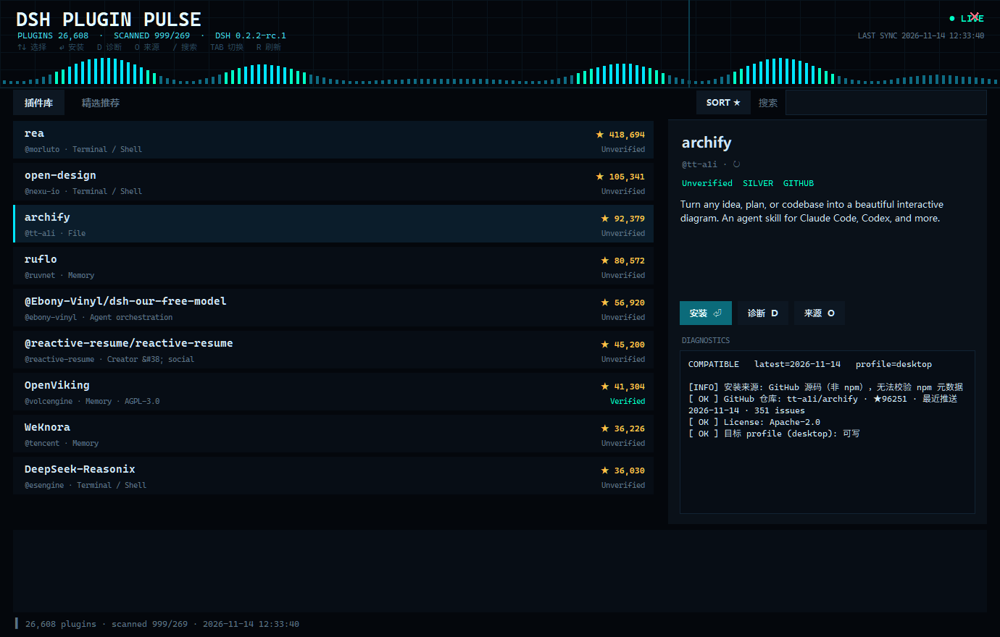
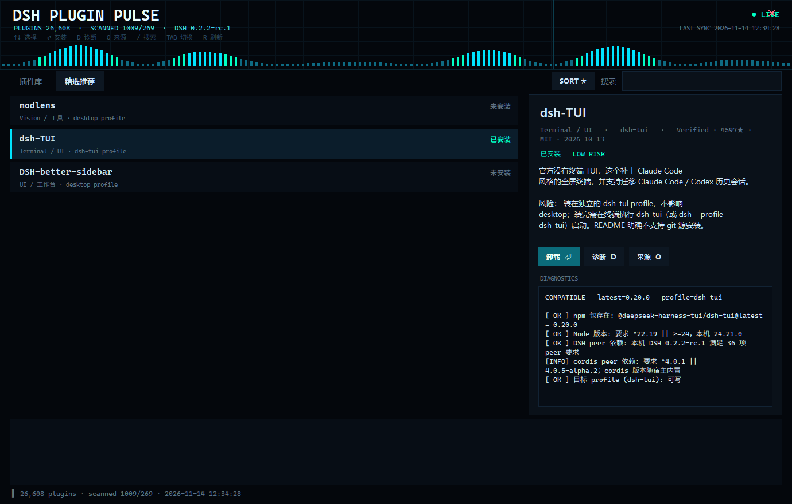
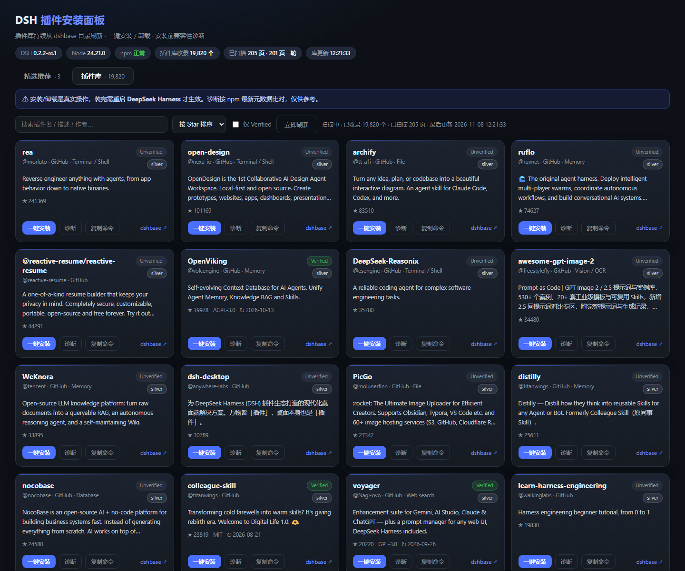

# DSH 插件安装面板 (DSH Plugin Installer)

> 给 [DeepSeek Harness](https://github.com/deepseek-ai/deepseek-harness) 用的可视化插件安装器：
> 把每日「优秀 DSH 插件简报」的精选变成可点击卡片，**一键安装 / 卸载**，安装前自动做**兼容性诊断**。

两个形态共用同一套数据与安装逻辑：

- **原生脉冲版（推荐）**：Tkinter 桌面窗口，无浏览器、无本地网页服务，科技脉冲动效 + 自绘外壳
- **网页版**：本地 127.0.0.1 服务 + 浏览器面板（适合多标签、宽屏浏览）







## 功能

- **插件库（持续刷新）**：后台线程按页抓取 [dshbase 插件目录](https://dshbase.com/plugins/directory/)（约 2 万个插件），
  一页接一页循环扫描，数据本地持久化；面板显示「已收录 / 已扫描页数 / 最后刷新」，并每 5 秒自动刷新统计。
  支持**搜索**（名称/描述/作者）、**排序**（Star / 最近更新 / 名称）、**仅 Verified** 过滤、分页浏览。
- **一键安装 / 卸载**：调用 DSH 官方 CLI（`dsh plugin --profile <profile> add|remove <spec>`，内部转发 pnpm），
  npm 包与 `github:owner/repo` 两种来源都支持；安装成功后自动写入 profile 的 `dsh.profile.bundles`
- **按需诊断**：插件库里每个插件都有「诊断」按钮，单插件实时检查 GitHub 仓库 / npm 元数据 / 兼容性
- **兼容性诊断（精选）**：安装前逐项检查
  - 本机 DSH 版本（读取 `DeepSeek Harness.exe` 运行版本）
  - 本机 Node 版本 vs 插件 `engines.node`
  - 插件 `peerDependencies` 中的 `@deepseek-ai/dsh-*` 范围 vs 本机 DSH 版本
  - 目标 profile 是否存在 / 可写 / 已装插件
  - npm registry 连通性与包是否存在
  - 结论：`兼容 / 待核实 / 不兼容`
- **实时日志**：安装/卸载过程实时滚动，失败给出退出码
- **自定义包**：直接输入 npm 包名（`pkg`、`@scope/pkg@1.2.3`）或 `github:owner/repo` 安装
- **单实例**：重复打开只会唤起浏览器，不会起第二个服务
- 只监听 `127.0.0.1`，不做任何静默下载

## 插件库刷新机制

- 服务启动后自动开一个后台线程，从第 1 页开始，每页取 ~100 个插件，逐页扫描，扫完 201 页后从头循环刷新
- 扫描进度持久化在 `%LOCALAPPDATA%\DSHPluginInstaller\plugins_store.json`，重启面板不会丢数据
- 节奏可用环境变量调整：`DSH_REFRESH_SLEEP`（每页间隔秒数，默认 2.5）
- 「立即刷新」按钮会把扫描指针重置回第 1 页（用于强制重新核对最新状态）

相关接口：

| 接口 | 说明 |
| --- | --- |
| `GET /api/plugins?q=&page=1&size=24&sort=stars&verified=0` | 分页查询插件库 |
| `GET /api/refresh/status` | 扫描进度、收录总数、最后刷新时间 |
| `POST /api/refresh` `{reset:true}` | 重置扫描指针 / 触发刷新 |
| `POST /api/diagnose-one` `{spec}` | 单插件兼容性诊断 |

## 桌面版（科技脉冲风格，推荐）

`pulse_panel.py` → `DSH-Plugin-Pulse.exe`

- 原生 Tkinter 窗口：**不启动浏览器、不占端口**，无系统标题栏，自绘深色外壳
- 顶部实时脉冲波形（青/绿频谱 + 扫描线），`LIVE` 表示插件库正在扫描
- 左列表 / 右详情：`↑↓` 选择、`⏎` 安装（精选里已安装的为卸载）、`D` 诊断、`O` 打开来源、`/` 搜索、`TAB` 切换精选/插件库、`R` 刷新、鼠标滚轮滚动、拖拽顶部移动窗口、点右上 `✕` 关闭
- 安装日志实时滚动在底部；诊断结果展示在右侧 DIAGNOSTICS 区
- 插件库列表滚动到底自动加载更多；搜索/排序复用同一数据层

启动：

- 双击桌面「DSH 插件脉冲面板」，或
- 双击 `启动脉冲面板.cmd`，或
- `python pulse_panel.py`（源码运行）

## 安装 / 使用

### 方式一：绿色包（推荐）

1. 下载 `DSH-Plugin-Pulse-win64.zip`（原生版，推荐）或 `DSH-Plugin-Installer-win64.zip`（网页版）并解压
2. 双击 `DSH-Plugin-Pulse.exe`（原生窗口，不需要浏览器）或 `DSH-Plugin-Installer.exe`（会打开 <http://127.0.0.1:8790/>）
3. 或运行 `install.ps1`：安装到 `%LOCALAPPDATA%\DSHPluginInstaller\` 并在桌面创建两个快捷方式

```powershell
powershell -ExecutionPolicy Bypass -File .\install.ps1
```

> 要求：本机已安装 DeepSeek Harness 桌面版（会自动探测安装目录与 profile）。
> 安装/卸载插件需要 pnpm，DSH 自带运行时里已经包含。

### 方式二：源码运行

```powershell
python pulse_panel.py     # 原生脉冲窗口
python server.py          # 网页版，然后打开 http://127.0.0.1:8790/
```

### 方式三：自行打包

```powershell
powershell -ExecutionPolicy Bypass -File .\build.ps1
```

产物：

- `dist\DSH-Plugin-Pulse\` + `release\DSH-Plugin-Pulse-win64.zip`（原生脉冲版）
- `dist\DSH-Plugin-Installer\` + `release\DSH-Plugin-Installer-win64.zip`（网页版）

## 兼容性诊断规则

| 检查项 | 规则 |
| --- | --- |
| DSH 版本 | 运行 `DeepSeek Harness.exe --expose-internals ...\cli.js --version` 获取 |
| Node 版本 | 取 DSH 自带运行时 `node.exe --version` |
| `engines.node` | 按简化版 semver 判断（支持 `>=`、`>`、`<=`、`<`、`^`、`~`、`||`、精确版本） |
| `@deepseek-ai/dsh-*` peer | 用本机 DSH 版本比对插件最新版的 peer 范围 |
| `@deepseek-ai/cordis` peer | cordis 版本随宿主内置，面板只提示不判定 |
| npm 包 | 直查 `https://registry.npmjs.org/<pkg>/latest` |
| profile | 读取 `~/.dsh/profiles/<profile>/package.json` 的 dependencies 与 bundles |

> 诊断基于 npm 上**最新版本**的元数据，参考意义为主，不构成安全审计。

## catalog.json

面板数据源为 `catalog.json`（exe 首次运行会复制一份到 `%LOCALAPPDATA%\DSHPluginInstaller\catalog.json`，
之后改这份即可，无需重新打包）。字段：

```json
{
  "id": "唯一 id",
  "name": "显示名",
  "spec": "npm 包名@版本",
  "bundle": "写入 bundles 的包名",
  "profile": "desktop",
  "category": "类别",
  "summary": "一句话价值",
  "verified": "Verified · star · license · 日期",
  "risk": "high | medium | low",
  "riskNote": "风险说明",
  "source": "来源链接",
  "command": "等价的 dsh plugin 命令"
}
```

## 目录结构

```
server.py              数据层 + 网页版本地服务：catalog / 诊断 / 安装 / 日志 / 插件库扫描
ui.html                网页版前端（原生 JS，无构建步骤）
pulse_panel.py         原生脉冲版（Tkinter 窗口，复用 server.py 的数据与安装逻辑）
catalog.json           精选推荐数据
assets/                图标与截图
build.ps1              打包两个版本（PyInstaller onedir + zip）
install.ps1            安装到 LOCALAPPDATA + 创建桌面快捷方式
启动脉冲面板.cmd        启动原生脉冲版
启动安装面板.cmd        启动网页版
```

## 安全说明

- 面板只做「装 / 卸」，所有命令与输出都可见
- 只接受 npm 包名格式（正则校验），不支持 `github:` / `file:` 等任意源
- 插件的实际权限面需要自行复核：面板展示的风险等级来自简报，不是安全审计
- 装完/卸载后需要重启 DeepSeek Harness 才会生效

## License

MIT
